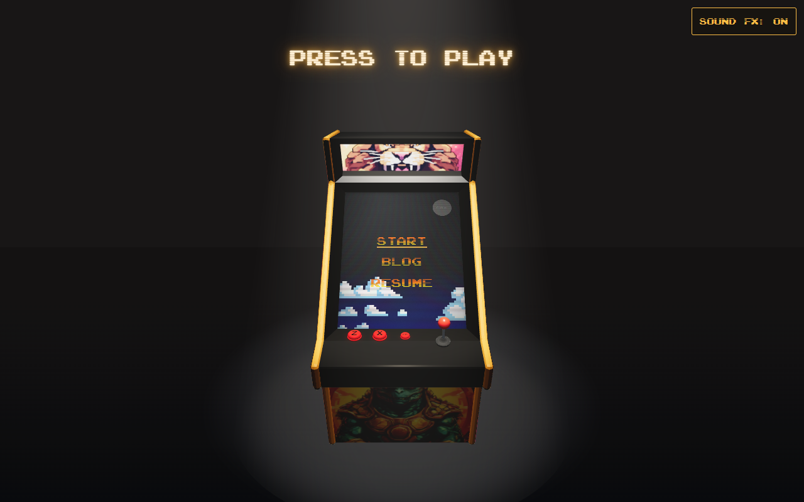

# Rad's Arcade

A playable arcade cabinet for Radmehr Vafadar's portfolio, built with React Three Fiber, Three.js, and a pixel-art museum.

[](https://www.radmehr.ca/)

[Play the arcade](https://www.radmehr.ca/) · [Browse the visual changelog](https://www.radmehr.ca/changelog/) · [Open the portfolio](https://www.radmehr.ca/portfolio/)

Hover to step up to the cabinet, or tap **Play**.
Use the joystick and buttons, or a keyboard:

| Move | Read / choose | Open | Start / menu |
| --- | --- | --- | --- |
| WASD / arrows | Z | X | C |

Inside Punch-Out, tap C for Start, hold C for two seconds to return, and use Esc or P to pause.

## Features

- Arcade at `/` with hover camera zoom on desktop and automatic zoom after loading on mobile.
- Included portfolio at `/portfolio/` inside the cabinet screen.
- Walkable pixel museum, playable Punch-Out exhibit, Markdown blog, and resume PDF.
- Visual changelog at `/changelog/`, with screenshots going back to the first prototype.
- One install, development command, build, and deployment.

## Quick start

Use an active Node.js LTS release with npm.

```bash
npm ci
npm run dev
```

Open [the cabinet](http://127.0.0.1:5173/), [the portfolio](http://127.0.0.1:5173/portfolio/), or [the changelog](http://127.0.0.1:5173/changelog/).
The launcher starts both apps and proxies portfolio requests and hot reload through the arcade server.
Set `VITE_IFRAME_URL` in root `.env.local` to use an external site for the iframe and loading-screen portfolio link.

Install Chromium once with `npx playwright install chromium`, then run `npm run check` for all checks.
On PowerShell with script execution disabled, use `npm.cmd` and `npx.cmd`.

## Production build

Build both apps into root `dist/` and preview the production site locally:

```bash
npm run build
npm run preview
```

Deploy root `dist/` at the domain root using `npm run build` as the build command.
`npm run deploy` builds and publishes the same combined output using gh-pages.

## Docs

- [Development](docs/development.md) - commands, testing, deployment, and import provenance.
- [Scene](docs/scene.md) - cabinet rendering and iframe configuration.
- [Changelog](docs/changelog.md) - milestone selection, screenshot sources, and editing.
- [Portfolio](apps/portfolio/README.md) - landing page, game, and content.
